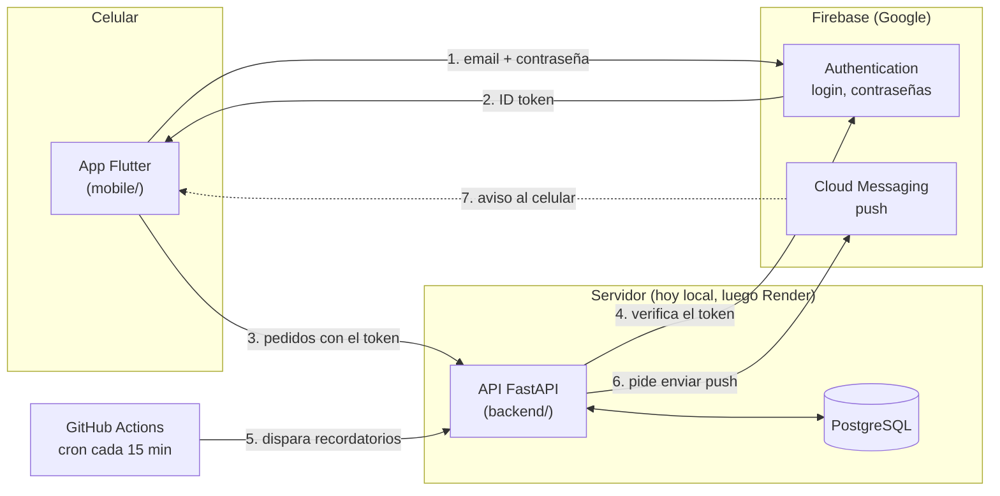
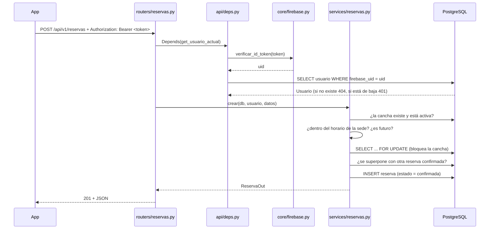
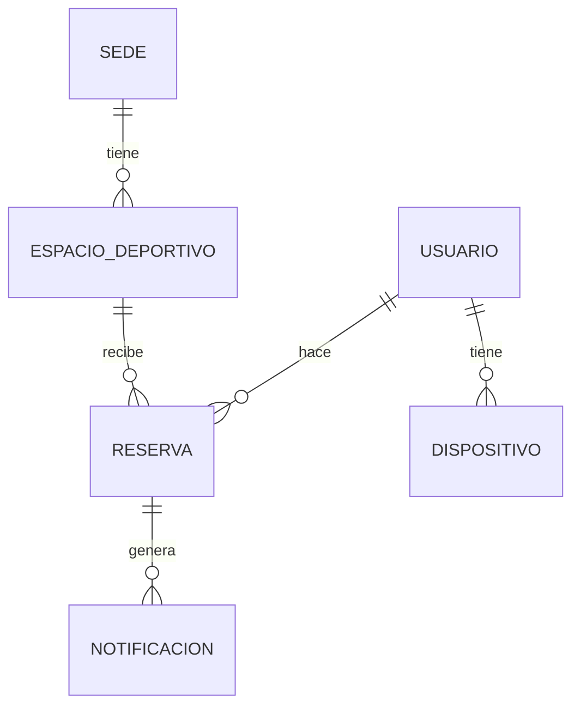
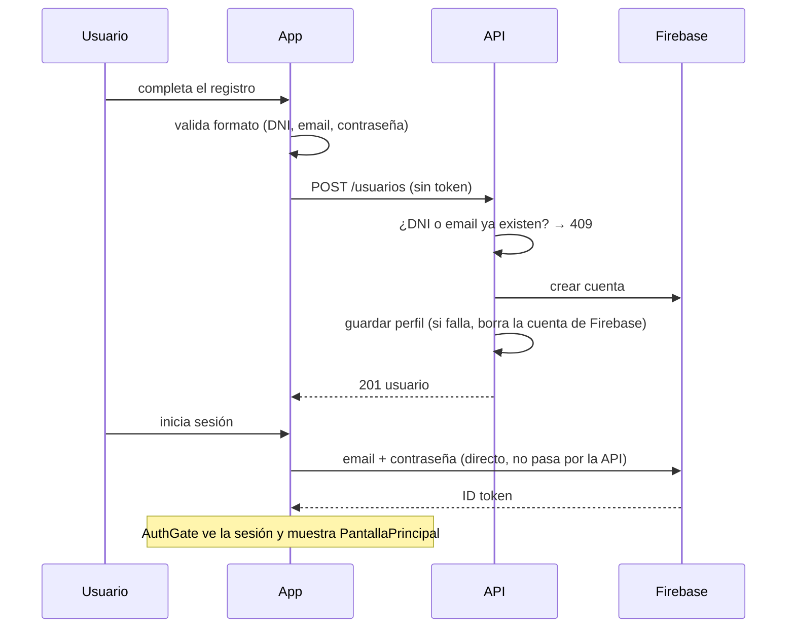
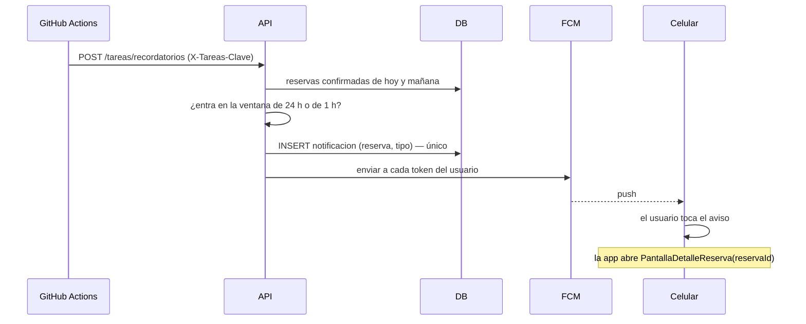

# Guía del código — cómo entender todo ClubMartinianoHerenu

> Para estudiar el proyecto de punta a punta y poder defenderlo. Está escrita
> contando **qué hace cada pieza, por qué está ahí y en qué orden conviene leerla**.
> Todo lo que dice acá está verificado contra el código (nombres de archivos,
> funciones y códigos de error reales).
>
> Estado: Entrega 2 completa salvo el deploy en Render. 4 sedes, 22 canchas;
> 145 casos de prueba en el backend y 121 en la app.

## Índice

0. [Cómo usar esta guía](#0-cómo-usar-esta-guía)
1. [El proyecto en una página](#1-el-proyecto-en-una-página)
2. [Mapa del repositorio](#2-mapa-del-repositorio)
3. [Backend (FastAPI + PostgreSQL)](#3-backend-fastapi--postgresql)
4. [App móvil (Flutter)](#4-app-móvil-flutter)
5. [Flujos de punta a punta](#5-flujos-de-punta-a-punta)
6. [Dónde está cada caso de uso](#6-dónde-está-cada-caso-de-uso)
7. [Decisiones de diseño y su porqué](#7-decisiones-de-diseño-y-su-porqué)
8. [Cómo correrlo y probarlo](#8-cómo-correrlo-y-probarlo)
9. [Preguntas típicas de la defensa](#9-preguntas-típicas-de-la-defensa)
10. [Glosario](#10-glosario)
11. [Limitaciones conocidas (para decirlas vos antes que te las pregunten)](#11-limitaciones-conocidas)

---

## 0. Cómo usar esta guía

**Si tenés poco tiempo, leé solo esto y la sección 1.**

### Las 6 ideas que sostienen todo el proyecto

1. **Tres piezas, cada una con un trabajo.**
   - La **app** (Flutter) muestra pantallas y manda pedidos.
   - La **API** (FastAPI) aplica las reglas de negocio y es la única que habla con la base.
   - **Firebase** sabe *quién es* cada persona (login) y entrega los push.
2. **La contraseña nunca pasa por nuestra API.** La app inicia sesión directo con
   Firebase, recibe un *ID token* y lo manda en cada pedido. La API lo verifica.
3. **La app no decide reglas.** No calcula si un horario está libre ni si una reserva
   se puede cancelar: lo pregunta a la API. Por eso las reglas están en un solo lugar.
4. **El backend está en capas** que se leen en orden: *router → service → modelo*.
   El router recibe el pedido, el service aplica las reglas, el modelo es la tabla.
5. **Todos los errores tienen la misma forma** (`{"error": {"codigo", "mensaje"}}`).
   La app traduce cada código a una pantalla o un mensaje.
6. **Todo lo externo se puede reemplazar en los tests** (Firebase, el reloj, la API).
   Por eso hay tantos tests sin internet.

### Orden de lectura recomendado

| Paso | Qué leer | Para entender |
|---|---|---|
| 1 | Sección 1 y 2 de esta guía | La foto general |
| 2 | `backend/app/main.py` → `api/router.py` → `api/routers/reservas.py` | Cómo entra un pedido |
| 3 | `backend/app/services/reservas.py` | Dónde están las reglas |
| 4 | `backend/app/models/reserva.py` y `schemas/reserva.py` | La tabla y el JSON |
| 5 | `backend/app/api/deps.py` y `core/firebase.py` | Cómo se sabe quién sos |
| 6 | `mobile/lib/main.dart` → `app/app.dart` → `features/auth/auth_gate.dart` | Cómo arranca la app |
| 7 | `mobile/lib/features/shell/pantalla_principal.dart` | La estructura con pestañas |
| 8 | `mobile/lib/core/api_client.dart` y `data/reservas_api.dart` | Cómo la app habla con la API |
| 9 | `mobile/lib/features/horarios/pantalla_horarios.dart` | Una pantalla completa (la tuya, CU-12) |

### Mini-diccionario para no perderte

| Término | Qué es, en una línea |
|---|---|
| **Endpoint** | Una URL de la API que hace algo (`POST /api/v1/reservas`). |
| **Router** (FastAPI) | Archivo que agrupa endpoints y declara qué entra y qué sale. |
| **Service** | Función con la lógica de negocio. No sabe de HTTP. |
| **Modelo** | Clase Python que representa una tabla (SQLAlchemy). |
| **Schema** (Pydantic) | Clase que define la forma y valida un JSON de entrada o salida. |
| **Migración** (Alembic) | Archivo versionado que cambia el esquema de la base. |
| **Dependency** (`Depends`) | Función que FastAPI ejecuta antes del endpoint (ej. "verificá el token"). |
| **Widget** (Flutter) | Todo lo que se ve es un widget: un texto, un botón, una pantalla entera. |
| **StatelessWidget / StatefulWidget** | Sin memoria / con memoria (`setState` lo redibuja). |
| **Provider** | Mecanismo para "inyectar" un objeto (ej. el cliente HTTP) a todo un subárbol. |
| **`context.read` / `context.watch`** | Leer un provider una vez / leerlo y redibujar cuando cambie. |
| **Future / async / await** | Una operación que termina más tarde (un pedido a la red). |
| **ID token** | Credencial temporal que Firebase le da a la app y que prueba quién es el usuario. |

---

## 1. El proyecto en una página

**Qué es:** una app para reservar canchas deportivas en 4 sedes (Morón, Ramos Mejía,
San Justo, Castelar) con 22 canchas. Alcance: todo el lado *usuario*; no hay panel de
administración (sedes y canchas se cargan con un script, el *seed*).



**Qué hace cada pieza:**

| Pieza | Responsabilidad | Qué NO hace |
|---|---|---|
| **App** | Pantallas, formularios, validar formato, mostrar errores, guardar el modo oscuro | Reglas de negocio, hablar con la base |
| **API** | Reglas (horarios, superposición, cancelación), acceso a datos, verificar identidad, mandar push | Guardar contraseñas, dibujar nada |
| **PostgreSQL** | Guardar usuarios, sedes, canchas, reservas, dispositivos, avisos | Lógica |
| **Firebase Auth** | Cuentas, contraseñas, ID tokens, email de recuperación | Perfil (nombre, DNI…): eso vive en nuestra base |
| **Firebase FCM** | Entregar el push al celular | Decidir cuándo avisar |
| **GitHub Actions** | Llamar a la API cada 15 minutos | Ninguna lógica: solo despierta a la API |

**Identificar a una persona:** Firebase la conoce por un `uid`. Nuestra tabla `usuario`
guarda ese `uid` en `firebase_uid` junto con nombre, DNI, etc. Así "quién sos" (Firebase)
y "qué datos tenés" (nuestra base) quedan unidos por un solo campo.

---

## 2. Mapa del repositorio

```
ClubMartinianoHerenu/
├── backend/                 API REST (Python)
│   ├── app/                 todo el código de la API
│   │   ├── main.py          arranca FastAPI y monta los routers
│   │   ├── core/            piezas base: config, errores, firebase, hora
│   │   ├── db/              conexión a PostgreSQL y base de los modelos
│   │   ├── models/          las tablas (SQLAlchemy)
│   │   ├── schemas/         las formas de los JSON (Pydantic)
│   │   ├── services/        las reglas de negocio
│   │   ├── api/             routers (endpoints) y dependencias
│   │   └── seed.py          carga las 4 sedes y 22 canchas
│   ├── alembic/             migraciones de la base
│   ├── tests/               pruebas automáticas (pytest)
│   ├── docker-compose.yml   PostgreSQL local
│   ├── requirements*.txt    dependencias
│   └── .env.example         plantilla de variables de entorno (el .env real NO se sube)
├── mobile/                  App (Flutter / Dart)
│   ├── lib/                 todo el código de la app
│   │   ├── main.dart        punto de entrada
│   │   ├── app/             MaterialApp, tema, modo claro/oscuro
│   │   ├── core/            cliente HTTP, errores, auth, push, formatos
│   │   ├── data/            un archivo por recurso de la API (modelos + llamadas)
│   │   ├── widgets/         piezas visuales reutilizables
│   │   └── features/        una carpeta por pantalla/flujo
│   ├── test/                pruebas automáticas
│   ├── assets/              imágenes (fotos del Figma, ícono)
│   ├── android/             proyecto Android nativo (permisos, ícono, canal de push)
│   └── tool/                script que genera el ícono
├── docs/                    documentación (CONTEXTO, arquitectura, modelo de datos…)
├── .github/workflows/       el cron de recordatorios
└── design/                  (reservado para el Figma)
```

**Regla mental:** si es *servidor*, está en `backend/`; si es *pantalla*, en
`mobile/lib/features/`; si es *cómo hablan entre sí*, en `docs/arquitectura.md`.

---

## 3. Backend (FastAPI + PostgreSQL)

### 3.1 Qué se usó y por qué

| Herramienta | Para qué | Por qué esa y no otra |
|---|---|---|
| **FastAPI** | Armar la API | Liviano, valida con tipos y genera **Swagger** solo (`/docs`) |
| **SQLAlchemy 2** | Hablar con la base con clases Python (ORM) | Estándar de Python; evita escribir SQL a mano |
| **Alembic** | Versionar cambios de la base (migraciones) | El esquema queda en git, reproducible en Render |
| **PostgreSQL 16** | Base de datos | Lo pide el TP; maneja bien fechas, horas y bloqueos |
| **Pydantic** | Validar JSON de entrada/salida | Viene con FastAPI; si falla, responde 422 sola |
| **firebase-admin** | Verificar tokens, crear/borrar cuentas, mandar push | SDK oficial |
| **pytest** | Tests | Estándar |
| **Docker** | PostgreSQL local | "Levantar la base" es un solo comando |

### 3.2 Las capas y quién puede llamar a quién

```
HTTP  →  api/routers  →  services  →  models  →  PostgreSQL
              │             │
              ▼             ▼
          schemas        core (config, errores, firebase, hora)
```

| Capa | Carpeta | Responsabilidad | Regla de oro |
|---|---|---|---|
| **Entrada** | `api/routers/` | Declarar el endpoint, sus parámetros y qué devuelve | No tiene lógica: llama a un service |
| **Seguridad** | `api/deps.py` | "¿Quién es?" y "¿tiene permiso?" | Corre *antes* del endpoint |
| **Reglas** | `services/` | Validar, decidir, guardar | No sabe de HTTP (lanza `ErrorAPI`, no devuelve respuestas) |
| **Datos** | `models/` | Una clase = una tabla, con sus restricciones | Sin lógica de negocio |
| **Forma del JSON** | `schemas/` | Qué campos entran y salen, y sus validaciones de formato | No toca la base |
| **Base** | `core/`, `db/` | Configuración, errores, Firebase, reloj, sesión de base | Nadie de acá arriba depende de las capas de arriba |

> **Por qué separar así:** si mañana cambia la regla de cancelación, se toca
> `services/reservas.py` y nada más. El router y la tabla no se enteran.

### 3.3 Recorrido de un pedido real: reservar una cancha

`POST /api/v1/reservas` con `{espacio_id, fecha, hora_inicio, duracion}`:



**Paso a paso, con archivos:**

1. `app/main.py` crea `app = FastAPI(...)`, registra el formato de errores y monta
   `api_router` (prefijo `/api/v1`).
2. `app/api/router.py` suma los routers: usuarios, catálogo, disponibilidad,
   reservas, notificaciones y tareas.
3. `app/api/routers/reservas.py` → `crear_reserva()`. Recibe `ReservaIn` (el schema
   valida que la hora sea "en punto" y la duración 1 o 2). `Depends(get_usuario_actual)`
   se ejecuta primero.
4. `app/api/deps.py` → `get_uid_autenticado()` verifica el token con
   `core/firebase.verificar_id_token`; `get_usuario_actual()` busca el usuario por
   `firebase_uid`.
5. `app/services/reservas.py` → `crear()` aplica las reglas **en este orden**:

   | # | Regla | Si falla |
   |---|---|---|
   | 1 | La cancha existe y está activa | 404 `ESPACIO_NO_ENCONTRADO` |
   | 2 | Hora completa y 1 o 2 horas | 422 `DATOS_INVALIDOS` (lo corta el schema) |
   | 3 | Entra en el horario de la sede | 400 `HORARIO_FUERA_DE_SEDE` |
   | 4 | Es en el futuro | 400 `HORARIO_PASADO` |
   | 5 | No pisa otra reserva confirmada | 409 `HORARIO_OCUPADO` |

6. **Concurrencia:** antes del paso 5 hace `SELECT ... FOR UPDATE` sobre la fila de la
   cancha. Si dos personas reservan el mismo turno a la vez, la segunda *espera* a que
   la primera termine y recién ahí verifica, ya viendo la reserva nueva → recibe 409.
   Sin esto, las dos podrían guardar.
7. Se guarda con `precio_total = precio_hora × duración` (**foto del precio**: si el
   precio cambia después, la reserva no se altera) y se devuelve `ReservaOut`.

### 3.4 Archivo por archivo

#### `app/` (raíz)

| Archivo | Qué hace |
|---|---|
| `main.py` | Crea la aplicación FastAPI, instala el manejo de errores, monta `/api/v1` y define `/` y `/health` |
| `seed.py` | Carga las 4 sedes y 22 canchas del Figma. **Idempotente**: si lo corrés dos veces, actualiza y no duplica. `python -m app.seed` |

#### `app/core/` — piezas base

| Archivo | Qué hace | Para entenderlo |
|---|---|---|
| `config.py` | Clase `Settings`: lee `.env` / variables de entorno (`DATABASE_URL`, `FIREBASE_CREDENTIALS`, `TAREAS_CLAVE`, `ZONA_HORARIA`, `ENVIRONMENT`) y expone el objeto `settings` | Todo el que necesite una configuración hace `from app.core.config import settings` |
| `errores.py` | `ErrorAPI(status, codigo, mensaje)` y los manejadores que convierten **cualquier** error en `{"error": {"codigo", "mensaje"}}` | Mirá `registrar_manejadores_de_error`: captura errores de negocio, de validación (422), 404/405 del framework y errores inesperados (500 sin detalles internos) |
| `firebase.py` | Inicialización *perezosa* del Admin SDK y 4 operaciones: `verificar_id_token`, `crear_usuario`, `eliminar_usuario`, `enviar_notificacion` | Los tests lo reemplazan completo (ver 3.11). Distingue `TokenDeDispositivoInvalido` (hay que borrar el token) de `EnvioFallido` (reintentar) |
| `tiempo.py` | `ahora()` devuelve la hora de Argentina | **Regla:** nunca `datetime.now()` suelto. Render corre en UTC y desde las 21 h la API creería que ya es mañana |

#### `app/db/` — conexión

| Archivo | Qué hace |
|---|---|
| `base.py` | `Base`: la clase de la que heredan todos los modelos |
| `session.py` | `engine` (conexión a PostgreSQL), `SessionLocal` (fábrica de sesiones) y `get_db()`: la dependencia que le da una sesión a cada pedido y la cierra al terminar |

#### `app/models/` — las tablas

| Archivo | Tabla | Notas |
|---|---|---|
| `usuario.py` | `usuario` | `firebase_uid` único; `activo=false` = dado de baja. **No guarda contraseña** |
| `sede.py` | `sede` | `hora_apertura`/`hora_cierre` (un horario para todos los días), `activa`, `imagen_url` |
| `espacio_deportivo.py` | `espacio_deportivo` | `deporte` + `tipo` + `numero` (únicos por sede), `nombre_compuesto` único, `precio_hora`, `cubierto`, `iluminacion` |
| `reserva.py` | `reserva` | `fecha`, `hora_inicio`, `hora_fin`, `precio_total`, `estado` (`confirmada`/`cancelada`) |
| `dispositivo.py` | `dispositivo` | Token de FCM de cada celular (`fcm_token` único) |
| `notificacion.py` | `notificacion` | Un aviso enviado; **único por (reserva, tipo)** para no repetir |
| `__init__.py` | — | Importa todos: Alembic y SQLAlchemy necesitan conocerlos |

#### `app/schemas/` — la forma del JSON

| Archivo | Clases principales |
|---|---|
| `usuario.py` | `RegistroUsuario` (valida DNI de 7–8 dígitos, fecha pasada, contraseña ≥ 8), `EdicionUsuario`, `UsuarioOut`, `DispositivoIn` |
| `catalogo.py` | `SedeOut`, `SedeResumen`, `EspacioOut`, `DeporteOut` |
| `disponibilidad.py` | `FranjaOut`, `DisponibilidadOut` |
| `reserva.py` | `ReservaIn` (exige hora en punto), `ReservaOut` (incluye `estado` visible, `cancelable` y `recordatorios`) |
| `notificacion.py` | `RecordatorioOut`, `NotificacionOut`, `ResumenRecordatoriosOut` |

#### `app/services/` — las reglas

| Archivo | Funciones clave | Qué resuelve |
|---|---|---|
| `usuarios.py` | `registrar`, `actualizar`, `dar_de_baja`, `registrar_dispositivo`, `eliminar_dispositivo` | Registro en dos pasos con *deshacer* si falla; baja que cancela reservas futuras y anonimiza |
| `catalogo.py` | `listar_sedes`, `listar_espacios`, `listar_deportes`, `obtener_espacio_activo` | Solo muestra lo reservable (sede y cancha activas); ordena F5 < F7 < F11 con "orden natural" |
| `disponibilidad.py` | `calcular_franjas` (pura), `consultar` | **CU-12**. Ver 3.7 |
| `reservas.py` | `crear`, `listar`, `obtener`, `cancelar`, `estado_visible`, `reserva_out` | CU-08, CU-09 y CU-10 |
| `notificaciones.py` | `enviar_recordatorios`, `avisar_cancelacion`, `recordatorio_que_corresponde`, `recordatorios_de`, `listar_avisos` | CU-24. Ver 3.8 |
| `nombres.py` | `generar_nombre_compuesto` | `Moron_Rivadavia_17500_Futbol_F5_1` (formato pedido por el TP) |

#### `app/api/` — la puerta de entrada

| Archivo | Endpoints |
|---|---|
| `router.py` | Junta todos los routers bajo `/api/v1` |
| `deps.py` | `get_uid_autenticado`, `get_usuario_actual`, `exigir_clave_de_tareas` |
| `routers/usuarios.py` | `POST /usuarios` (público), `GET/PUT/DELETE /usuarios/me`, `POST /usuarios/me/dispositivos`, `DELETE /usuarios/me/dispositivos/{token}` |
| `routers/catalogo.py` | `GET /sedes`, `/sedes/{id}`, `/espacios` (filtros `sede_id`, `deporte`, `tipo`), `/espacios/{id}`, `/deportes` |
| `routers/disponibilidad.py` | `GET /espacios/{id}/disponibilidad?fecha=&duracion=` |
| `routers/reservas.py` | `POST /reservas`, `GET /reservas?vista=proximas\|historial`, `GET /reservas/{id}`, `DELETE /reservas/{id}` |
| `routers/notificaciones.py` | `GET /notificaciones` (panel de la campana) |
| `routers/tareas.py` | `POST /tareas/recordatorios` (lo llama el cron, protegido por clave) |

### 3.5 Base de datos



**Restricciones que defienden los datos** (están en el modelo *y* en la migración, o
sea que la base las exige aunque falle el código):

| Tabla | Restricción | Qué evita |
|---|---|---|
| `reserva` | `estado IN ('confirmada','cancelada')` | Estados inventados |
| `reserva` | `hora_fin > hora_inicio` | Reservas con horas al revés |
| `reserva` | minutos y segundos = 0 | Reservas que no son "en punto" (requisito del TP) |
| `reserva` | `precio_total >= 0` | Precios negativos |
| `espacio_deportivo` | único (`sede`, `deporte`, `tipo`, `numero`) | Dos "Fútbol F5 Cancha 1" en la misma sede |
| `notificacion` | único (`reserva`, `tipo`) | Mandar el mismo recordatorio dos veces |
| `dispositivo` | `fcm_token` único | El mismo celular registrado dos veces |

**"Completada" y "en curso" no se guardan:** se *derivan* de la fecha, la hora y el
estado (`estado_visible` en `services/reservas.py`). Así no hace falta ningún proceso
que actualice estados cuando pasa el tiempo.

### 3.6 Autenticación: cómo se sabe quién sos

```
App ──(email, contraseña)──▶ Firebase Auth ──(ID token)──▶ App
App ──(Authorization: Bearer <token>)──▶ API
API ──verifica firma y vencimiento──▶ Firebase Admin SDK ──▶ uid
API ──SELECT usuario WHERE firebase_uid = uid──▶ PostgreSQL ──▶ Usuario
```

| Situación | Respuesta |
|---|---|
| Sin header, token inválido o vencido | **401** `NO_AUTENTICADO` |
| Token válido pero sin perfil en la base (registro a medias) | **404** `PERFIL_NO_ENCONTRADO` |
| Cuenta dada de baja | **401** `NO_AUTENTICADO` |

- Las rutas privadas usan `Depends(get_usuario_actual)`. En `catalogo` y
  `disponibilidad` está a nivel de router (`APIRouter(dependencies=[...])`), así que
  cubre todos sus endpoints.
- **Ver reservas ajenas:** pedir `GET /reservas/{id}` de otra persona responde **404**
  (no 403): así no se revela que esa reserva existe.
- Tolerancia de reloj: `verify_id_token(..., clock_skew_seconds=60)`. Pasó en
  desarrollo que un reloj atrasado 13 segundos rechazaba tokens válidos.

### 3.7 Las reglas importantes explicadas

#### CU-12: horarios disponibles (`services/disponibilidad.py`)

La disponibilidad **no se guarda**: se calcula en cada consulta con tres datos: el
horario de la sede, la duración elegida y las reservas confirmadas de esa cancha ese día.

`calcular_franjas()` es una **función pura** (no toca la base ni el reloj; todo entra
por parámetro), por eso es fácil de testear:

```
Sede 08:00–23:00, duración 1 h, reservas confirmadas: 18–19 y 20–22, hoy son las 15:30
08–09 pasado · 09–10 pasado · … · 15–16 pasado
16–17 libre · 17–18 libre · 18–19 OCUPADO · 19–20 libre · 20–21 OCUPADO · 21–22 OCUPADO · 22–23 libre
```

- Con 2 horas las franjas son 08–10, 09–11, … y la última termina justo al cierre.
- Dos rangos `[a,b)` y `[c,d)` se superponen si `a < d` y `c < b`. Que se *toquen*
  (19:00 con 19:00) **no** es superposición.
- Una franja no disponible trae `motivo`: `ocupado` o `pasado`.
- Las reservas **canceladas no cuentan**: cancelar libera el horario.
- Pedir un día pasado → 400 `FECHA_PASADA`.

#### CU-10: cancelar (`services/reservas.cancelar`)

Solo se cancela una reserva **propia, confirmada y que no empezó**. No se borra: pasa a
`cancelada` y guarda `cancelada_en`. Si ya empezó, terminó o estaba cancelada → 409
`RESERVA_NO_CANCELABLE` (con mensaje distinto para cada caso).

#### CU-07: baja de cuenta (`services/usuarios.dar_de_baja`)

1. Cancela las reservas futuras (libera esos horarios).
2. Borra sus dispositivos.
3. **Anonimiza** `email`, `dni` y `firebase_uid` (`baja-<id>`): la persona puede volver a
   registrarse con los mismos datos y no quedan datos personales de una cuenta eliminada.
4. Marca `activo = false` (la fila queda para que el historial no tenga huecos).
5. Borra la cuenta de Firebase.

#### CU-03: registro en dos pasos con "deshacer" (`services/usuarios.registrar`)

Valida DNI y email → crea la cuenta en Firebase → guarda el perfil. **Si el paso 3
falla, borra la cuenta del paso 2**: no quedan cuentas a medias.

### 3.8 Notificaciones push del lado del servidor (CU-24)

```
cron (GitHub Actions, cada 15 min)
   └─▶ POST /api/v1/tareas/recordatorios   (header X-Tareas-Clave)
         └─▶ services.notificaciones.enviar_recordatorios()
               ├─ busca reservas confirmadas de hoy y mañana
               ├─ decide qué recordatorio toca (24 h o 1 h)
               ├─ inserta una fila en `notificacion` (única por reserva+tipo)
               └─ firebase.enviar_notificacion() a cada celular del usuario
```

- **Ventanas:** el de 24 h sale desde 24 h antes hasta 1 h antes; el de 1 h, desde 1 h
  antes hasta que empieza. **No se avisa a quien reservó ya dentro de la ventana** (acaba
  de hacerlo y ya lo sabe).
- **Sin duplicados:** la restricción única (`reserva`, `tipo`) hace que el mismo
  recordatorio no se repita aunque el cron corra seguido o dos corridas se pisen.
- **Reintentos:** si el usuario no tenía celular (`no_enviada`) o Firebase falló
  (`error`), se reintenta en la corrida siguiente mientras siga la ventana. `enviada` es
  definitivo.
- **Token inválido:** si FCM dice que el celular ya no existe, se borra de `dispositivo`.
- **Cancelación:** `reservas.cancelar` llama a `avisar_cancelacion` *después* del commit;
  si el push falla, la cancelación igual quedó hecha (los errores se registran en el log).
- **Seguridad del cron:** `exigir_clave_de_tareas` compara con `secrets.compare_digest`.
  Si `TAREAS_CLAVE` no está configurada, el endpoint rechaza todo (401 `CLAVE_INVALIDA`).
- **Por qué un cron externo:** Render gratis duerme el servidor sin tráfico, así que un
  temporizador interno no correría. El cron lo despierta y además es gratis.
- Cada push lleva `{"tipo", "reserva_id"}` para que la app abra el detalle al tocarlo.

### 3.9 Errores: un solo formato

```json
{"error": {"codigo": "HORARIO_OCUPADO", "mensaje": "El horario seleccionado ya no está disponible. Elegí otro."}}
```

| Código | HTTP | Cuándo |
|---|---|---|
| `NO_AUTENTICADO` | 401 | Token ausente, inválido, vencido o cuenta de baja |
| `PERFIL_NO_ENCONTRADO` | 404 | Token válido sin perfil en la base |
| `DATOS_INVALIDOS` | 422 | Falla la validación del schema (formato) |
| `EMAIL_YA_REGISTRADO`, `DNI_YA_REGISTRADO` | 409 | Registro o edición con datos que ya existen |
| `SEDE_NO_ENCONTRADA`, `ESPACIO_NO_ENCONTRADO`, `RESERVA_NO_ENCONTRADA` | 404 | Recurso inexistente, inactivo o ajeno |
| `FECHA_PASADA` | 400 | Consultar horarios de un día que pasó |
| `HORARIO_FUERA_DE_SEDE`, `HORARIO_PASADO` | 400 | Reservar fuera del horario o en el pasado |
| `HORARIO_OCUPADO` | 409 | Alguien tomó ese turno |
| `RESERVA_NO_CANCELABLE` | 409 | Ya empezó, terminó o estaba cancelada |
| `CLAVE_INVALIDA` | 401 | El cron no mandó la clave correcta |
| `NO_ENCONTRADO`, `METODO_NO_PERMITIDO` | 404 / 405 | Ruta o método inexistente |
| `ERROR_INTERNO` | 500 | Error inesperado (el detalle va al log, no al cliente) |

### 3.10 Migraciones, seed y entorno

- **Migraciones:** `alembic/versions/…_modelo_inicial.py` crea las 6 tablas.
  `alembic/env.py` toma la URL de `settings` (no de `alembic.ini`) e importa `app.models`
  para que `--autogenerate` vea las tablas. Comando: `alembic upgrade head`.
- **Seed:** `app/seed.py` define el catálogo como datos (`CATALOGO`) y lo carga con
  `cargar_catalogo()`. Los precios vistos en el Figma están marcados; los demás son
  **estimados** y el horario de San Justo también (hay que confirmarlo con el grupo).
- **Entorno:** `.env` (no se sube a git) con `DATABASE_URL`, `FIREBASE_CREDENTIALS`
  (ruta al JSON; en Render, el contenido del JSON) y `TAREAS_CLAVE`. `.env.example` es la
  plantilla. El `.gitignore` excluye `.env*`, `*firebase-adminsdk*.json` y
  `google-services.json`.
- **Docker:** `docker-compose.yml` levanta PostgreSQL 16 en el puerto **5433** (para no
  chocar con un Postgres nativo en el 5432).

### 3.11 Cómo están armados los tests del backend

`backend/tests/conftest.py` es la pieza clave:

| Mecanismo | Qué logra |
|---|---|
| Base separada `clubdb_test` (se crea sola y recibe las migraciones) | Los tests **nunca** tocan los datos de desarrollo |
| Cada test corre en una transacción que se deshace (`rollback`) | Todos arrancan con la base limpia |
| `FirebaseFalso` (autouse) reemplaza `verificar_id_token`, `crear_usuario`, `eliminar_usuario`, `enviar_notificacion` | Sin internet; el token `token-<uid>` vale para ese uid; registra los push enviados |
| `monkeypatch.setattr(tiempo, "ahora", ...)` en cada archivo | Reloj fijo (ej. miércoles 14/10/2026 15:30) |
| Fixture `cliente` | `TestClient` de la API real usando la sesión de prueba |

| Archivo | Cubre |
|---|---|
| `test_auth.py` | Token faltante/inválido/vencido, cuenta de baja, perfil inexistente |
| `test_usuarios.py` | Registro, perfil, edición, baja, dispositivos |
| `test_catalogo.py` | Sedes, canchas, filtros combinables, canchas y sedes inactivas ocultas, deportes para los chips |
| `test_disponibilidad.py` | Grilla, superposición, "pasado", 1 y 2 horas, canceladas |
| `test_reservas.py` | Crear (todas las validaciones), listar, detalle, cancelar, **concurrencia** con hilos |
| `test_notificaciones.py` | Ventanas, textos, idempotencia, reintentos, token inválido, clave, panel, recordatorios del detalle |
| `test_errores.py` | Formato único: error de negocio, 422 con el campo, 500 sin detalles internos, ruta inexistente |
| `test_seed.py` | 4 sedes, 22 canchas, idempotencia |
| `test_firebase_real.py` / `test_firebase_token.py` | Contra Firebase real (se saltean sin credenciales) |

---

## 4. App móvil (Flutter)

### 4.1 Qué se usó

| Paquete | Para qué |
|---|---|
| `firebase_core`, `firebase_auth` | Iniciar sesión, registrar tokens, cambiar contraseña |
| `firebase_messaging` | Recibir push (FCM) |
| `http` | Pedidos a la API |
| `provider` | Inyectar objetos y estado a los widgets |
| `shared_preferences` | Recordar el modo oscuro y "ya vi las notificaciones" |
| `google_fonts` | Barlow Condensed, Inter y DM Mono del Figma |
| `intl` | Solo `DateFormat` en el registro |
| `flutter_launcher_icons` (dev) | Generar el ícono de Android |

### 4.2 Arquitectura en capas

```
features/  (pantallas)   ──usa──▶  data/ (modelos + llamadas a la API)
    │                                  │
    ├──usa──▶ widgets/ (piezas)        └──usa──▶ core/api_client
    └──usa──▶ core/ (errores, auth, push, formatos)  +  app/tema
```

| Carpeta | Responsabilidad | Regla |
|---|---|---|
| `core/` | Infraestructura sin pantallas: HTTP, errores, auth, push, formatos, configuración | No importa nada de `features` |
| `data/` | **Un archivo por recurso de la API**: la clase modelo (`Reserva`, `Sede`…) + la clase `XxxApi` con sus llamadas | No dibuja nada |
| `widgets/` | Piezas visuales que se repiten en varias pantallas | No saben de negocio |
| `app/` | `MaterialApp`, tema y modo claro/oscuro | |
| `features/` | Una carpeta por pantalla o flujo | Cada pantalla usa `data/` y `widgets/`, no otras pantallas (salvo navegar) |

**Patrón que se repite en todo el proyecto — "interfaz + implementación real + falsa":**

| Interfaz | Real | Falsa (tests) |
|---|---|---|
| `ServicioAuth` | `AuthFirebase` | `AuthFalso` |
| `ServicioNotificaciones` | `NotificacionesFirebase` | `NotificacionesFalso` |
| `ApiClient` (acepta un `http.Client`) | `http.Client()` | `MockClient` + `ServidorFalso` |

Así los tests de pantallas corren sin Firebase ni red.

### 4.3 Cómo arranca la app

```
main.dart
  └─ Firebase.initializeApp()
  └─ runApp(AppClub(auth: AuthFirebase()))
        app/app.dart  ── MultiProvider(ServicioAuth, ServicioNotificaciones, ApiClient, ControladorTema)
          └─ MaterialApp(tema claro/oscuro, locale es_AR, home: AuthGate)
               features/auth/auth_gate.dart   ── escucha auth.cambios
                 ├─ sin sesión ─▶ PantallaLogin  (→ PantallaRegistro, PantallaRecuperar)
                 └─ con sesión ─▶ PantallaPrincipal
                                     features/shell/pantalla_principal.dart
                                       ├─ pestaña Inicio   → PantallaInicio
                                       ├─ pestaña Sedes    → PantallaSedes → PantallaSede → PantallaHorarios
                                       ├─ pestaña Reservas → PantallaReservas → PantallaDetalleReserva
                                       └─ pestaña Perfil   → PantallaPerfil
```

**`AuthGate`** es el truco central: es un `StreamBuilder` sobre `auth.cambios`. Cuando
el usuario inicia o cierra sesión, ese stream emite y la app **cambia sola** de Login a
Principal (o al revés). Ninguna pantalla "navega" al login: simplemente deja de haber
sesión.

### 4.4 Qué se provee y dónde (Provider)

| Provider | Dónde se crea | Qué es | Quién lo usa |
|---|---|---|---|
| `ServicioAuth` | `AppClub` | Login, logout, cambio de contraseña | Pantallas de auth, perfil, `ApiClient` |
| `ServicioNotificaciones` | `AppClub` | FCM | `PantallaPrincipal`, flujo de baja |
| `ApiClient` | `AppClub` | Cliente HTTP con token | Todas las `XxxApi` |
| `ControladorTema` | `AppClub` | Modo claro/oscuro (guardado en el celular) | `AppClub`, perfil |
| `NavegacionPrincipal` | `PantallaPrincipal` | `irA`, `abrirSede`, `abrirReserva` | Home, campana, horarios |
| `ReservasCambiadas` | `PantallaPrincipal` | Aviso "cambiaron tus datos, recargá" | Home, Mis reservas, horarios, cancelación |
| `ControladorNotificaciones` | `PantallaPrincipal` | Permiso, registro del token, campana | Home, perfil |

> **Detalle importante:** `NavegacionPrincipal`, `ReservasCambiadas` y
> `ControladorNotificaciones` solo existen *dentro* de `PantallaPrincipal`. Las pantallas
> que se abren en el navegador **raíz** (confirmación de reserva, cambiar contraseña,
> baja de cuenta) no los ven; por eso reciben callbacks o usan solo los providers de
> `AppClub`.

### 4.5 Navegación

- **Cuatro `Navigator` independientes**, uno por pestaña, dentro de un `IndexedStack`.
  Ventajas: la barra inferior queda visible al entrar a una sede o a una reserva (como
  en el Figma) y cada pestaña **conserva su pila** al cambiar de una a otra.
- **Pestañas perezosas** (`_visitadas`): una pestaña no se construye ni pide datos hasta
  que la visitás.
- **Botón Atrás** (`PopScope`): cierra lo apilado en la pestaña; si no hay nada, vuelve a
  Inicio; recién ahí sale de la app.
- **Navegador raíz** (`rootNavigator: true`) para pantallas completas sin barra:
  "¡Reserva confirmada!", cambiar contraseña y baja de cuenta.
  Consecuencia: esas pantallas **no se descartan solas** al cerrar sesión; por eso
  hacen `popUntil((r) => r.isFirst)` antes de `cerrarSesion()`.
- **Abrir una reserva desde un push:** `PantallaPrincipal._abrirReserva(id)` cambia a la
  pestaña Reservas, vacía su pila y apila `PantallaDetalleReserva(reservaId: id)`.
  El detalle recibe **solo el id** y pide la reserva a la API: sirve igual si se abre
  desde la lista o desde una notificación.

### 4.6 Cómo la app habla con la API

```
Pantalla ─▶ ReservasApi.crear() ─▶ ApiClient.post('/reservas', body)
                                       ├─ arma la URL (Config.apiUrl + /api/v1)
                                       ├─ pide el ID token a Firebase y manda Authorization: Bearer
                                       ├─ aplica timeout (60 s: Render gratis se duerme)
                                       └─ traduce la respuesta o el error a un ErrorApp
```

**Jerarquía de errores** (`core/errores.dart`) — toda falla llega a la pantalla como un
`ErrorApp`:

| Clase | Cuándo | Qué muestra la app |
|---|---|---|
| `SinConexion` | Sin red, timeout, servidor inalcanzable | Tarjeta "Error de conectividad" |
| `ErrorServidor` | 5xx o respuesta ilegible | Tarjeta "Error del servidor" |
| `CredencialesInvalidas` | Login rechazado por Firebase | Mensaje genérico (no dice si falló el email o la contraseña) |
| `NoAutenticado` | 401 de la API | Cierra sesión y vuelve al login |
| `ErrorNegocio(codigo, mensaje, status)` | 4xx con `{"error": …}` | El `mensaje` de la API, y el `codigo` decide qué hacer |

**Pieza clave `widgets/carga_async.dart`:**

- `CargaAsync<T>(cargar:, construir:)`: muestra *cargando* → *error con Reintentar* →
  *datos*. Casi todas las pantallas que leen datos lo usan.
- Si el error es `NoAutenticado` o `PERFIL_NO_ENCONTRADO`, **cierra la sesión** (la
  cuenta no sirve).
- `mostrarFallo(context, error)`: qué hacer cuando falla una **acción** (no una carga):
  sesión inútil → logout; sin conexión o servidor → tarjeta; error de negocio →
  `SnackBar` con el mensaje de la API.

### 4.7 Archivo por archivo

#### `lib/app/`

| Archivo | Qué hace |
|---|---|
| `app.dart` | `AppClub`: crea los providers globales y el `MaterialApp` (tema, idioma es-AR, `home: AuthGate`) |
| `tema.dart` | **Sistema de diseño**: `Colores` (lima `#D4FF00`, fondo `#050508`…), `Tipografia` (títulos Barlow Condensed, texto Inter, códigos DM Mono), `temaClaro`/`temaOscuro` y la extensión `ColoresDeContexto` (`context.colorTexto`, `colorAcento`, `colorTarjeta`… que cambian solos entre claro y oscuro) |
| `controlador_tema.dart` | `ChangeNotifier` con el modo; lo guarda en `shared_preferences` |

#### `lib/core/`

| Archivo | Qué hace |
|---|---|
| `config.dart` | `Config.apiUrl` (por defecto `http://10.0.2.2:8000`, `--dart-define=API_URL=` para cambiar), `apiPrefijo`, `timeoutApi` |
| `api_client.dart` | `get/post/put/delete`; token, timeout, y traducción de todo a `ErrorApp` |
| `errores.dart` | La jerarquía `ErrorApp` de arriba |
| `servicio_auth.dart` | `ServicioAuth` (interfaz) + `AuthFirebase`: iniciar sesión, cerrar, recuperar contraseña, **cambiar contraseña** (re-autentica con la actual y aplica la nueva). Traduce errores de Firebase |
| `servicio_notificaciones.dart` | `ServicioNotificaciones` + `NotificacionesFirebase`: permiso, token, avisos en primer plano, tocados y aviso inicial |
| `formato.dart` | Precios (`$ 3.800`), fechas (`sáb, 15 ago`), DNI con puntos, hora del club, etiquetas de tipo (`F5` → `Fútbol 5`), orden de deportes. **Escrito a mano** (sin `intl`) para no depender del idioma del celular |

#### `lib/data/` (modelo + llamadas por recurso)

| Archivo | Modelos | Llamadas |
|---|---|---|
| `usuarios_api.dart` | `Usuario` | `registrar`, `miPerfil`, `editarPerfil`, `eliminarCuenta` |
| `catalogo_api.dart` | `Sede`, `SedeResumen`, `Espacio`, `DeporteConTipos` | `sedes({deporte})`, `espacios({sedeId, deporte, tipo})` |
| `disponibilidad_api.dart` | `Disponibilidad`, `Franja` | `consultar(espacioId, fecha, duracion)` |
| `reservas_api.dart` | `Reserva`, `Recordatorio` | `crear`, `obtener`, `cancelar`, `listar(vista)` |
| `notificaciones_api.dart` | `AvisoRecibido` | `registrarDispositivo`, `quitarDispositivo`, `listar` |

#### `lib/widgets/` (reutilizables)

| Archivo | Qué es |
|---|---|
| `barra_inferior.dart` | Inicio · Sedes · Reservas · Perfil |
| `carga_async.dart` | Cargando / error / datos (ver 4.6) y `VistaFallo` |
| `tarjeta_error.dart` | Las tarjetas "Error de conectividad" y "Error del servidor" del Figma |
| `etiquetas.dart` | `ChipDeporte`, `ChipTipo`, `EtiquetaDeporte`, `EtiquetaCondicion` |
| `imagen_catalogo.dart` | Fotos de sedes y canchas (incluidas en la app, elegidas por nombre) |
| `selector_segmentado.dart` | Barra de opciones ("1 hora / 2 horas", "Próximas / Historial") |

#### `lib/features/`

| Carpeta / archivo | Qué hace |
|---|---|
| `auth/auth_gate.dart` | Decide Login vs. app según la sesión |
| `auth/pantalla_login.dart` | CU-01: formulario, validación local, errores |
| `auth/pantalla_registro.dart` | CU-03: formulario con selector de fecha; llama a `POST /usuarios` |
| `auth/pantalla_recuperar.dart` | Pide a Firebase el email de recuperación |
| `auth/componentes_auth.dart` | Fondo con foto, campos translúcidos, botón lima, banner de error |
| `auth/validaciones.dart` | Formato de email, DNI y contraseña (respuesta instantánea sin llamar a la API) |
| `shell/pantalla_principal.dart` | Barra inferior, 4 navegadores, escucha de push, providers de sesión |
| `shell/navegacion_principal.dart` | `Pestana`, `NavegacionPrincipal` y `ReservasCambiadas` |
| `inicio/pantalla_inicio.dart` | Home: saludo, **próxima reserva**, chips de deporte, sedes, campana y tarjeta de recordatorios |
| `sedes/pantalla_sedes.dart` | CU-16: las 4 sedes |
| `sedes/pantalla_sede.dart` | CU-13/20: canchas con filtro por deporte y tipo (cada cambio vuelve a pedir a la API) |
| `sedes/tarjeta_cancha.dart` | Tarjeta de una cancha |
| `horarios/pantalla_horarios.dart` | **CU-12 + CU-09**: cancha, fecha (14 días), duración, grilla de franjas, resumen y "Confirmar" |
| `horarios/pantalla_reserva_confirmada.dart` | "¡Reserva confirmada!", se cierra sola y lleva a Reservas |
| `reservas/pantalla_reservas.dart` | CU-08: Próximas (N) / Historial |
| `reservas/tarjeta_reserva.dart` | Tarjeta con estado (Activa, En curso, Completada, Cancelada) |
| `reservas/pantalla_detalle_reserva.dart` | Detalle por id, **bloque Recordatorios** y botón Cancelar |
| `reservas/pantalla_cancelar_reserva.dart` | CU-10: confirmación; devuelve `true` si canceló |
| `perfil/pantalla_perfil.dart` | CU-05/06: datos, edición en el lugar, modo oscuro, seguridad, cerrar sesión, baja |
| `perfil/pantalla_cambiar_password.dart` | CU-04: requisitos y fortaleza en vivo |
| `perfil/pantalla_eliminar_cuenta.dart` | CU-07: `FlujoEliminarCuenta` = encuesta → procesando → gracias |
| `notificaciones/controlador_notificaciones.dart` | Permiso, registro/renovación/baja del token, "visto hasta" |
| `notificaciones/widgets_notificaciones.dart` | Modal de permiso, campana + panel, tarjeta "Recordatorios activos" |

### 4.8 Ideas de diseño de la app que conviene entender

- **Pantalla = `StatefulWidget` con el estado que le hace falta.** Ej. `PantallaHorarios`
  guarda `_espacio`, `_fecha`, `_duracion`, `_horaElegida`. Cualquier cambio de filtro
  llama a `_cambiar(...)`, que limpia la franja elegida y redibuja; el `FutureBuilder`
  de la grilla vuelve a consultar.
- **`_recarga`**: un contador que obliga a consultar de nuevo sin que cambie ningún
  filtro (cuando alguien nos ganó de mano el horario).
- **`ReservasCambiadas`**: como las pestañas viven en un `IndexedStack`, no se
  reconstruyen solas. Al crear o cancelar una reserva (o editar el perfil) se llama
  `avisar()`; Home y Mis reservas escuchan y vuelven a pedir sus datos.
- **Home pide tres cosas en paralelo** (`Future.wait`): perfil, sedes y próximas
  reservas. Se usa `Future.wait` (y no los registros de Dart 3) porque deja pasar el
  error original, que se necesita para distinguir "sin conexión" de "sesión vencida".
- **Validar dos veces:** la app valida formato para responder al instante; la API lo
  vuelve a validar porque es la autoridad.
- **Tema:** ninguna pantalla pone colores a mano; usa `context.colorTexto`,
  `colorAcento`… que devuelven el valor correcto según el modo.
- **Las fotos del Figma viajan dentro de la app** (`assets/images`); la API tiene
  `imagen_url` por si algún día se cargan propias.

### 4.9 Android (lo nativo)

| Archivo | Para qué |
|---|---|
| `android/app/src/main/AndroidManifest.xml` | Permisos (`INTERNET`, `POST_NOTIFICATIONS`), nombre `ClubMartinianoHerenu`, ícono, y los `meta-data` de FCM (ícono, color y canal) |
| `android/app/src/debug/AndroidManifest.xml` | Permite HTTP sin cifrar **solo en debug** (la API local) |
| `…/MainActivity.kt` | Crea el canal de notificaciones `recordatorios` (importancia alta) |
| `android/app/google-services.json` | Configuración de Firebase (**secreto, no se sube**) |
| `res/mipmap-*`, `drawable-*`, `values/colors.xml` | Ícono adaptativo, pantalla de arranque oscura, color de las notificaciones |
| `res/drawable/ic_notificacion.xml` | Ícono monocromo del monograma para la barra de estado |
| `tool/generar_icono.dart` | Dibuja el monograma "CH" con formas y deja los PNG en `assets/icon/` |

### 4.10 Tests de la app

`test/ayudas.dart` + `test/servidor_falso.dart` son la base:

| Pieza | Qué hace |
|---|---|
| `abrirApp(tester, auth:, servidor:, notificaciones:)` | Arma `AppClub` completo con fakes |
| `AuthFalso` | Sesión en memoria; registra intentos, enlaces y cambios de contraseña |
| `NotificacionesFalso` | Permiso y token controlables; `tocarAviso`, `llegarAviso`, `renovarToken` |
| `ServidorFalso` | Una API completa en memoria detrás de `MockClient`: usuarios, sedes, canchas, disponibilidad, reservas, dispositivos y avisos; guarda cada pedido |

| Archivo | Cubre |
|---|---|
| `api_client_test.dart` | Token en el header, JSON, 204 sin cuerpo y traducción de 409/401/500/502, sin red y timeout |
| `servicio_auth_test.dart` | Traducción de errores de Firebase |
| `validaciones_test.dart`, `formato_test.dart` | Validaciones y formatos |
| `auth_flujo_test.dart` | Login, registro, recuperar, sesión previa, 401 |
| `catalogo_flujo_test.dart` | Home, sedes, filtros, pestañas, cuenta sin perfil |
| `horarios_flujo_test.dart` | Grilla, cambio de cancha/fecha/duración, reservar, 409 |
| `reservas_flujo_test.dart` | Próximas, historial, detalle, cancelar |
| `perfil_flujo_test.dart` | Ver, editar, cambiar contraseña, baja |
| `notificaciones_flujo_test.dart` | Permiso, registro, tocar aviso, campana, recordatorios |

---

## 5. Flujos de punta a punta

### 5.1 Registro e inicio de sesión



### 5.2 Reservar y cancelar

1. Sede → cancha → `PantallaHorarios`: cada cambio llama a
   `GET /espacios/{id}/disponibilidad`.
2. El usuario elige una franja libre y toca **Confirmar**:
   `POST /reservas` → 201 → `ReservasCambiadas.avisar()` →
   "¡Reserva confirmada!" → pestaña Reservas.
3. Si alguien tomó el turno: 409 `HORARIO_OCUPADO` → aviso, se limpia la elección y la
   grilla se actualiza.
4. Cancelar: pantalla de confirmación → `DELETE /reservas/{id}` → pasa a `cancelada` →
   vuelve a la lista (Home y Reservas se recargan) → push "Reserva cancelada".

### 5.3 Un recordatorio, de punta a punta



### 5.4 Baja de cuenta

Perfil → "Eliminar cuenta" → confirmación en el lugar → encuesta (opcional, **no se
guarda**) → "Procesando…" → `DELETE /usuarios/me` (cancela futuras, anonimiza, borra de
Firebase) → "Gracias" → se olvida el token local, se cierra sesión y vuelve al login.

---

## 6. Dónde está cada caso de uso

| CU | Qué | Backend | App | Tests |
|---|---|---|---|---|
| 01 | Iniciar sesión | (Firebase) | `auth/pantalla_login.dart` | `auth_flujo_test` |
| 02 | Cerrar sesión | `DELETE /usuarios/me/dispositivos/{token}` | `perfil/pantalla_perfil.dart` | `notificaciones_flujo_test` |
| 03 | Registrarse | `POST /usuarios` · `services/usuarios.registrar` | `auth/pantalla_registro.dart` | `test_usuarios`, `auth_flujo_test` |
| 04 | Cambiar contraseña | (Firebase) | `perfil/pantalla_cambiar_password.dart` | `perfil_flujo_test` |
| 05 | Consultar perfil | `GET /usuarios/me` | `perfil/pantalla_perfil.dart` | `perfil_flujo_test` |
| 06 | Editar perfil | `PUT /usuarios/me` | `perfil/pantalla_perfil.dart` | `test_usuarios`, `perfil_flujo_test` |
| 07 | Dar de baja | `DELETE /usuarios/me` · `dar_de_baja` | `perfil/pantalla_eliminar_cuenta.dart` | `test_usuarios`, `perfil_flujo_test` |
| 08 | Mis reservas / historial | `GET /reservas?vista=` | `reservas/pantalla_reservas.dart` | `test_reservas`, `reservas_flujo_test` |
| 09 | Reservar | `POST /reservas` · `reservas.crear` | `horarios/pantalla_horarios.dart` | `test_reservas`, `horarios_flujo_test` |
| 10 | Cancelar | `DELETE /reservas/{id}` · `reservas.cancelar` | `reservas/pantalla_cancelar_reserva.dart` | `test_reservas`, `reservas_flujo_test` |
| **12** | **Horarios disponibles** | `GET /espacios/{id}/disponibilidad` · `disponibilidad.py` | `horarios/pantalla_horarios.dart` | `test_disponibilidad`, `horarios_flujo_test` |
| 13 | Consultar canchas | `GET /espacios` | `sedes/pantalla_sede.dart` | `test_catalogo`, `catalogo_flujo_test` |
| 16 | Consultar sedes | `GET /sedes` | `sedes/pantalla_sedes.dart` | `test_catalogo`, `catalogo_flujo_test` |
| 20 | Filtrar canchas | `GET /espacios?deporte=&tipo=` | chips en Home y `pantalla_sede.dart` | `test_catalogo`, `catalogo_flujo_test` |
| 24 | Notificaciones | `tareas`, `notificaciones`, `services/notificaciones.py` | `features/notificaciones/` y Home/Detalle | `test_notificaciones`, `notificaciones_flujo_test` |

No implementados a propósito: CU-11 (modificar reserva: se cancela y se reserva de nuevo),
CU-14/15/17–19/21–23 (administración) y CU-24.2 (cancelación forzosa por la sede).

---

## 7. Decisiones de diseño y su porqué

| Decisión | Por qué |
|---|---|
| **Login directo con Firebase** (sin `POST /auth/login` propio) | La contraseña nunca pasa por nuestra API; es lo que enseña el módulo 9 |
| **La API calcula la disponibilidad en cada consulta** | No hay que mantener un estado "libre/ocupado" que se pueda desincronizar |
| **`FOR UPDATE` al reservar** | Evita que dos personas reserven el mismo turno a la vez |
| **Estados `completada` y `en curso` derivados** | No hace falta un proceso que cambie estados con el paso del tiempo |
| **Cancelar = cambiar estado, no borrar** | El historial no tiene huecos y se registra cuándo se canceló |
| **Baja con anonimización** | Se puede volver a registrar con los mismos datos y no quedan datos personales |
| **404 y no 403 para reservas ajenas** | No se revela que existen |
| **Errores con un formato único + códigos estables** | La app decide por `codigo`, no por texto |
| **`ahora()` único y zona de Argentina** | Render corre en UTC; evita bugs de "ya es mañana" a las 21 h |
| **Cron externo para los recordatorios** | Render gratis duerme el servidor; un temporizador interno no correría |
| **Tabla `notificacion` con unicidad (reserva, tipo)** | Idempotencia: el cron puede correr varias veces sin duplicar |
| **Precio informativo, sin pagos** | El TP no pide pagos |
| **Seed en vez de panel de admin** | Fuera de alcance; las sedes y canchas se cargan por script |
| **Cuatro `Navigator` + `IndexedStack`** | La barra inferior persiste y cada pestaña conserva su estado |
| **Interfaces + fakes** (`ServicioAuth`, `ServicioNotificaciones`) | Tests rápidos sin Firebase ni red |
| **Formatos escritos a mano** | No dependen del idioma del celular ni de inicializar `intl` |
| **Una carpeta por feature** | Para tocar "Mis reservas" abrís una sola carpeta |
| **GitHub Flow con PRs y tags SemVer** | Pedido por la materia; el historial se evalúa |

---

## 8. Cómo correrlo y probarlo

### Backend

```bash
cd backend
docker compose up -d                 # PostgreSQL en el puerto 5433
py -3.13 -m venv .venv
.venv\Scripts\activate
pip install -r requirements-dev.txt
copy .env.example .env               # y completar FIREBASE_CREDENTIALS
alembic upgrade head                 # crea las tablas
python -m app.seed                   # carga 4 sedes y 22 canchas
uvicorn app.main:app --reload        # http://localhost:8000/docs (Swagger)
pytest                               # 145 casos
```

### App

```bash
cd mobile
flutter pub get
flutter run                          # emulador Android con Google Play
flutter run --dart-define=API_URL=https://mi-api.onrender.com   # otra API
flutter analyze
flutter test                         # 121 tests
```

### Regenerar el ícono

```bash
flutter test tool/generar_icono.dart
dart run flutter_launcher_icons
```

### Probar un recordatorio a mano (con la API local y `TAREAS_CLAVE` en `.env`)

```bash
curl -X POST http://localhost:8000/api/v1/tareas/recordatorios -H "X-Tareas-Clave: <clave>"
```

---

## 9. Preguntas típicas de la defensa

**¿Por qué no guardan la contraseña?** La administra Firebase Authentication. Nuestra
tabla solo guarda el `firebase_uid`. Menos superficie de ataque y menos código sensible.

**¿Cómo sabe la API quién hace el pedido?** La app manda el ID token de Firebase en
`Authorization: Bearer`. `get_uid_autenticado` lo verifica con el Admin SDK y
`get_usuario_actual` busca el perfil por `firebase_uid`.

**¿Qué pasa si dos personas reservan el mismo horario a la vez?** `crear()` bloquea la
fila de la cancha con `SELECT … FOR UPDATE`; la segunda espera, ve la reserva nueva y
recibe 409 `HORARIO_OCUPADO`. Hay un test con hilos que lo comprueba.

**¿Cómo calculan los horarios disponibles (CU-12)?** `calcular_franjas` arma franjas
de hora en hora entre apertura y cierre y marca `pasado` (ya empezó hoy) u `ocupado`
(se superpone con una reserva confirmada). No se guarda: se calcula en cada consulta.

**¿Por qué la disponibilidad la calcula la API y no la app?** Porque la API es la única
que ve todas las reservas y valida de nuevo al reservar; la app solo la muestra.

**¿Cómo evitan mandar el mismo recordatorio dos veces?** La tabla `notificacion` tiene
una restricción única (`reserva_id`, `tipo`) y el servicio inserta antes de enviar.

**¿Por qué un cron de GitHub Actions y no uno dentro de la API?** En el plan gratuito de
Render el servidor se duerme sin tráfico; un temporizador interno no correría.

**¿Qué pasa si falla Firebase al mandar un push?** El aviso queda como `error` y se
reintenta en la corrida siguiente mientras siga la ventana. Si es una cancelación, la
cancelación igual queda hecha.

**¿Cómo se prueba sin internet?** Los tests reemplazan Firebase (`FirebaseFalso`), el
reloj (`monkeypatch` de `tiempo.ahora`) y, en la app, la API (`ServidorFalso`).

**¿Qué cosas validan en la app y cuáles en la API?** El formato (email, DNI,
contraseña) se valida en la app para responder al instante; la API lo vuelve a validar.
Las reglas de negocio (horario, superposición, cancelación) viven **solo** en la API.

**¿Qué hacen cuando la sesión vence?** La API responde 401; `ApiClient` lo convierte en
`NoAutenticado`; `CargaAsync` o `mostrarFallo` cierran sesión y `AuthGate` muestra el login.

**¿Qué pasa con una cuenta dada de baja?** Sus reservas futuras se cancelan, el perfil se
anonimiza, se borra de Firebase y el token viejo deja de servir (401).

---

## 10. Glosario

| Palabra | Significado en este proyecto |
|---|---|
| **Sede** | Un club físico (Morón, Ramos Mejía, San Justo, Castelar) |
| **Espacio / cancha** | Algo reservable: `deporte` + `tipo` + `numero` dentro de una sede |
| **Franja** | Un intervalo reservable de 1 o 2 horas (`18:00–19:00`) |
| **Estado visible** | `confirmada`, `en_curso`, `completada` o `cancelada`; los dos del medio se derivan |
| **`cancelable`** | Booleano que manda la API: el botón "Cancelar" solo aparece si es `true` |
| **Seed** | Script que carga el catálogo inicial |
| **Dispositivo** | Un celular con su token de FCM |
| **Ventana** | Período en el que corresponde mandar un recordatorio |
| **Fake / falso** | Reemplazo en memoria de algo externo, para los tests |
| **Shell** | `PantallaPrincipal`: la estructura con la barra inferior |
| **FCM** | Firebase Cloud Messaging, el servicio de push |

---

## 11. Limitaciones conocidas

Es mejor decirlas vos antes de que te las pregunten:

1. **Deploy en Render pendiente.** Hoy todo corre en local. La base gratuita de Render
   dura 30 días, por eso se crea cerca de la fecha de entrega.
2. **La encuesta de salida no guarda las respuestas.** El Figma la pide, pero el backend
   no tiene dónde recibirlas (CU-07 sin especificación en el material del grupo).
3. **Precios y horario de San Justo estimados.** Los valores vistos en el Figma están
   marcados en `seed.py`; hay que confirmar el resto con el grupo.
4. **Solo Android.** El proyecto no tiene carpeta `ios`.
5. **Sin botones dentro del push** ("Ver reserva / Descartar" del Figma): FCM no los
   permite sin sumar una librería de notificaciones locales. Tocar el aviso hace lo mismo.
6. **"Leído" de la campana vive en el celular**, no en el servidor.
7. **`connectivity_plus` está declarado en `pubspec.yaml` pero no se usa**: la detección
   de "sin conexión" se hace desde los errores del cliente HTTP. Es candidato a quitarse.
8. **Los mensajes de Firebase no informan intentos restantes**, por eso al cambiar la
   contraseña el error no dice "te quedan N intentos" como el Figma.
9. **El push usa `Message.token`**, que el Admin SDK 7.x marca como obsoleto a favor de
   `fid`. Funciona y solo emite un aviso de deprecación.
