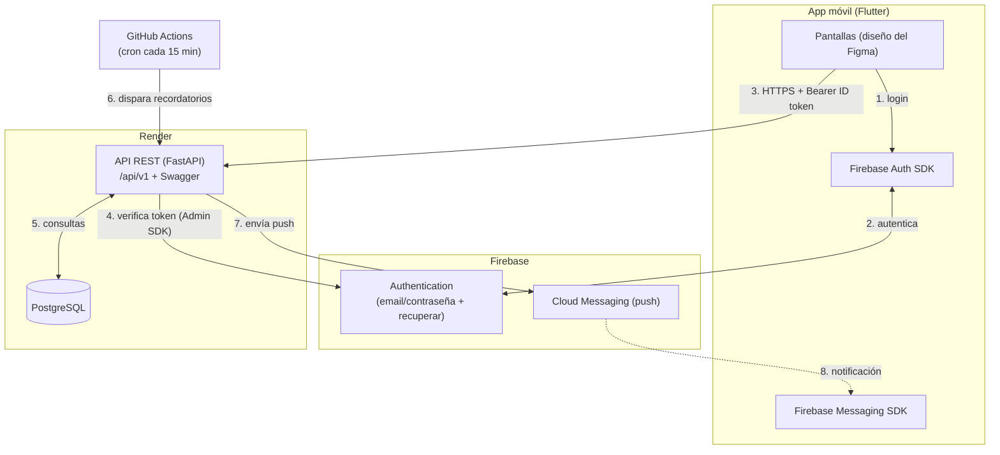

# Arquitectura — ClubMartinianoHerenu

> Versión 2 (2026-10-10). Basada en el módulo 9 (Firebase + Flutter + API) y en los
> módulos 10–11 (diseño de APIs REST).

## Diagrama general



## Autenticación

| Operación | Quién la resuelve |
|---|---|
| Registro (CU-03) | La **API** (`POST /usuarios`): valida que el email y el DNI no existan, crea el usuario en Firebase con el Admin SDK y guarda el perfil en PostgreSQL, todo en una sola operación. Si algo falla, se deshace. |
| Login (CU-01) | La **app**, directo contra Firebase (`signInWithEmailAndPassword`). |
| Recuperar contraseña | La **app**, con Firebase (`sendPasswordResetEmail`). Firebase manda el email. |
| Cambiar contraseña (CU-04) | La **app**, con Firebase (`updatePassword`, previa reautenticación). |
| Logout (CU-02) | La **app** (`signOut`) y borra su token de push en la API. |
| Identificar al usuario en cada request | La **API**: lee `Authorization: Bearer <token>`, lo verifica con el Admin SDK y obtiene el `uid`. |

> **Por qué el registro pasa por la API:** el CU-03 exige rechazar DNI duplicados, y
> eso solo lo sabe nuestra base. Si la app creara primero el usuario en Firebase y
> después fallara el perfil, quedaría una cuenta "huérfana".
>
> **Diferencia con la spec del CU-01:** la spec menciona `POST /auth/login`. En esta
> app el login no pasa por nuestra API sino por Firebase, que es el esquema del
> módulo 9: la contraseña nunca llega a nuestro servidor.

Un solo rol (usuario). El panel de administración del Figma queda fuera del alcance
de esta app; sedes y canchas se cargan por seed.

## Endpoints (`/api/v1`)

Convenciones del módulo 11: sustantivos en plural, minúsculas, sin verbos, versión
en la URL, todo en español.

| Método | Ruta | Auth | CU | Descripción |
|---|---|---|---|---|
| GET | `/health` | — | — | Estado de la API (lo usa Render). |
| POST | `/usuarios` | — | 03 | Registro: crea la cuenta en Firebase + perfil. |
| GET | `/usuarios/me` | ✔ | 05 | Perfil del usuario autenticado. |
| PUT | `/usuarios/me` | ✔ | 06 | Edita nombre, apellido, DNI y fecha de nacimiento (no el email). |
| DELETE | `/usuarios/me` | ✔ | 07 | Da de baja la cuenta. |
| POST | `/usuarios/me/dispositivos` | ✔ | 24 | Registra el token de push del celular. |
| DELETE | `/usuarios/me/dispositivos/{token}` | ✔ | 02 | Lo borra al cerrar sesión. |
| GET | `/sedes` | ✔ | 16 | Sedes con cantidad de canchas y deportes. |
| GET | `/sedes/{id}` | ✔ | 16 | Una sede. |
| GET | `/espacios` | ✔ | 13, 20 | Canchas, filtrables por `sede_id`, `deporte`, `tipo`. |
| GET | `/espacios/{id}` | ✔ | 16 | Ficha de una cancha. |
| GET | `/espacios/{id}/disponibilidad` | ✔ | **12** | Franjas de una fecha (`?fecha=2026-10-15&duracion=1`). |
| POST | `/reservas` | ✔ | 09 | Crea una reserva (valida reglas y superposición). |
| GET | `/reservas` | ✔ | 08 | Reservas del usuario (`?vista=proximas` o `?vista=historial`). |
| GET | `/reservas/{id}` | ✔ | 24 | Detalle (destino del toque en la notificación). |
| DELETE | `/reservas/{id}` | ✔ | 10 | Cancela (pasa a `cancelada`, no se borra). |
| GET | `/notificaciones` | ✔ | 24 | Avisos recibidos (panel de la campana en la Home). |
| POST | `/tareas/recordatorios` | clave | 24 | Lo llama el cron: envía los recordatorios pendientes. |

## Errores

Formato único para que la app sepa qué mostrar:

```json
{ "error": { "codigo": "HORARIO_OCUPADO", "mensaje": "El horario seleccionado ya no está disponible." } }
```

| HTTP | Cuándo | Ejemplo de `codigo` |
|---|---|---|
| 400 | Datos con formato válido pero que rompen una regla | `HORARIO_FUERA_DE_SEDE`, `HORARIO_PASADO` |
| 401 | Sin token, token vencido o inválido | `NO_AUTENTICADO` |
| 404 | El recurso no existe o no es del usuario | `RESERVA_NO_ENCONTRADA` |
| 409 | Conflicto con el estado actual | `HORARIO_OCUPADO`, `EMAIL_YA_REGISTRADO`, `DNI_YA_REGISTRADO`, `RESERVA_NO_CANCELABLE` |
| 422 | Faltan campos o tienen tipo incorrecto | `DATOS_INVALIDOS` |
| 500 | Error inesperado (sin detalles internos, módulo 11) | `ERROR_INTERNO` |

En la app, una capa traduce cada caso a lo que diseñó el grupo:
- **Sin internet** (el celular no tiene red) → tarjeta "Error de conexión a Internet".
- **Servidor caído o timeout / 5xx** → tarjeta "Error del servidor".
- **401** → vuelve al login (sesión expirada).
- **4xx de negocio** → mensaje inline con el `mensaje` de la API.

## Notificaciones push (CU-24)

- Al iniciar sesión, la app pide permiso de notificaciones, obtiene su token de FCM
  y lo registra en la API.
- **Recordatorios 24 h y 1 h antes:** un workflow de GitHub Actions corre cada
  15 minutos y llama a `POST /tareas/recordatorios`, protegido por una clave secreta.
  La API busca las reservas confirmadas que entran en la ventana, envía el push con
  el Admin SDK y lo registra en `notificacion`, que impide los envíos duplicados.
  - **Ventanas:** el aviso de 24 h va desde 24 h antes hasta 1 h antes; el de 1 h, desde
    1 h antes hasta el inicio. No se avisa a quien reservó ya dentro de la ventana.
  - **Reintentos:** si el usuario no tenía celular o Firebase falló, el aviso queda como
    `no_enviada` / `error` y se reintenta en la corrida siguiente.
  - **Protección:** el header `X-Tareas-Clave` se compara con `TAREAS_CLAVE`; sin clave
    configurada el endpoint rechaza todo (401 `CLAVE_INVALIDA`).
- **Aviso de cancelación (CU-24.3):** al cancelar una reserva, la API manda el push
  en el momento.
- Al tocar la notificación, la app abre el **detalle de la reserva**.

> **Por qué un cron externo y no un temporizador dentro de la API:** en el plan
> gratuito de Render el servidor se apaga tras 15 minutos sin tráfico, así que un
> temporizador interno no correría. El cron de GitHub Actions es gratis y, de paso,
> lo despierta.

## Hora y zona horaria

Render corre en UTC. Toda la lógica de "futuro", "pasado" y "hoy" usa la zona
`America/Argentina/Buenos_Aires`; si no, a partir de las 21 h la app pensaría que
ya es el día siguiente.

## Estructura del backend

```
backend/
├── app/
│   ├── main.py              # crea la app, monta routers y manejadores de error
│   ├── core/
│   │   ├── config.py        # variables de entorno
│   │   ├── firebase.py      # inicializa el Admin SDK
│   │   └── errores.py       # excepción de negocio + formato de error único
│   ├── db/                  # engine, sesión, Base
│   ├── models/              # tablas SQLAlchemy
│   ├── schemas/             # entrada/salida (Pydantic)
│   ├── api/
│   │   ├── deps.py          # get_db, get_usuario_actual (verifica el token)
│   │   └── routers/         # usuarios, sedes, espacios, reservas, tareas
│   ├── services/            # reglas: disponibilidad, reservas, notificaciones
│   └── seed.py              # catálogo del Figma
├── alembic/                 # migraciones
├── tests/                   # pytest
└── requirements.txt
```

## Estructura de la app (Flutter)

```
mobile/lib/
├── main.dart                # inicializa Firebase y el tema
├── app/                     # rutas, AuthGate (módulo 9), tema claro/oscuro
├── core/                    # cliente HTTP, manejo de errores, config de URL
├── data/                    # modelos (fromJson) y servicios por recurso
├── features/
│   ├── auth/                # login, registro, recuperar contraseña
│   ├── home/
│   ├── sedes/               # listado, sede, ficha de cancha
│   ├── horarios/            # CU-12 + confirmar reserva
│   ├── reservas/            # próximas, historial, detalle, cancelar
│   ├── perfil/              # ver, editar, cambiar contraseña, eliminar cuenta
│   └── notificaciones/
└── widgets/                 # componentes del sistema de diseño (botones, tarjetas, errores)
```

Paquetes previstos: `firebase_core`, `firebase_auth`, `firebase_messaging`, `http`,
`provider` (estado simple), `connectivity_plus` (detectar sin internet),
`google_fonts` (Barlow Condensed, DM Mono, Inter), `intl` (fechas),
`shared_preferences` (recordar el tema).
