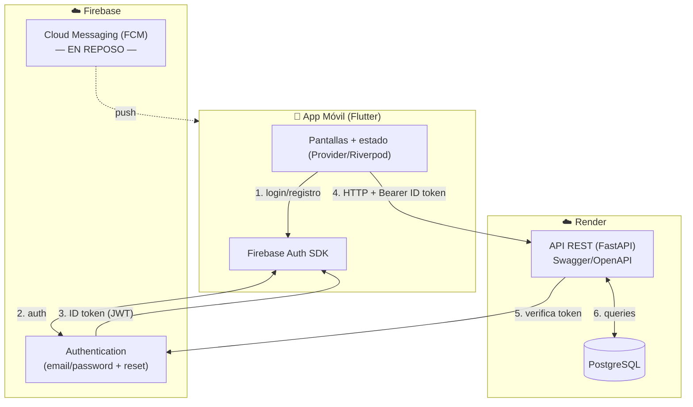

# Arquitectura — ClubMartinianoHerenu

## Diagrama general



## Flujo de autenticación (clave del TP)

1. El usuario se registra / inicia sesión **contra Firebase directamente** desde
   la app (Firebase Auth SDK de Flutter). Firebase resuelve registro, login,
   recuperación de contraseña y validación de email duplicado.
2. Firebase devuelve un **ID token (JWT)** a la app.
3. La app manda ese token en el header `Authorization: Bearer <token>` en cada
   request a la API.
4. FastAPI **verifica el token** con el Admin SDK de Firebase y obtiene el
   `firebase_uid`. Con eso identifica al usuario autenticado (requisito del enunciado).
5. La primera vez que un usuario válido llama a la API, se crea/actualiza su
   registro en la tabla `usuario` (nombre, apellido, fecha de nacimiento).

> Ventaja: no guardamos contraseñas en nuestra base. Firebase se encarga de toda
> la parte sensible de credenciales y del "olvidé mi contraseña".

## Componentes del backend (FastAPI)

```
backend/
├── app/
│   ├── main.py            # crea la app FastAPI, monta routers
│   ├── core/
│   │   ├── config.py      # settings (env vars): DB_URL, credenciales Firebase
│   │   └── firebase.py    # init Admin SDK + verificación de token
│   ├── db/
│   │   ├── session.py     # engine + SessionLocal (SQLAlchemy)
│   │   └── base.py        # Base declarativa
│   ├── models/            # tablas (SQLAlchemy): usuario, sede, espacio, reserva
│   ├── schemas/           # Pydantic (request/response)
│   ├── api/
│   │   ├── deps.py        # dependencia get_current_user (verifica token)
│   │   └── routers/       # usuarios, sedes, espacios, reservas
│   ├── services/          # lógica de negocio (validación de solapamiento, etc.)
│   └── seed.py            # carga inicial de sedes y espacios
├── alembic/               # migraciones
├── requirements.txt
├── .env.example
└── README.md
```

## Endpoints previstos (borrador)

| Método | Ruta                                   | Descripción                                  |
|--------|----------------------------------------|----------------------------------------------|
| GET    | `/me`                                  | Perfil del usuario autenticado               |
| PUT    | `/me`                                  | Editar perfil (no el email)                  |
| GET    | `/sedes`                               | Listar sedes con horarios                    |
| GET    | `/sedes/{id}/espacios`                 | Espacios de una sede (filtro `?tipo=`)       |
| GET    | `/espacios`                            | Listar todos los espacios (filtro `?tipo=`)  |
| GET    | `/espacios/{id}/disponibilidad?fecha=` | Horarios libres de un espacio en una fecha   |
| POST   | `/reservas`                            | Crear reserva (valida solapamiento)          |
| GET    | `/reservas`                            | Reservas del usuario (activas + historial)   |
| DELETE | `/reservas/{id}`                       | Cancelar reserva                             |

Toda ruta (salvo quizá el listado público de sedes) exige token válido.

## Validaciones de negocio en el backend

Al crear una reserva (`POST /reservas`), el servicio valida en orden:

1. Hora inicio y fin en **minuto 00** y `fin > inicio` (duración ≥ 1h).
2. Fecha/hora **futuras**.
3. `apertura_sede ≤ inicio` y `fin ≤ cierre_sede`.
4. **Sin solapamiento**: no existe otra reserva activa del mismo espacio, misma
   fecha, con rango horario que se cruce.

Si algo falla → error 4xx con mensaje claro (para que la app lo muestre).

## Manejo de errores (requisito)

- Backend: respuestas HTTP con código y mensaje (`{ "detail": "..." }`).
- App: capa que traduce errores de red / HTTP a mensajes de usuario
  (sin internet, server caído, login inválido, usuario duplicado, horario ocupado).
