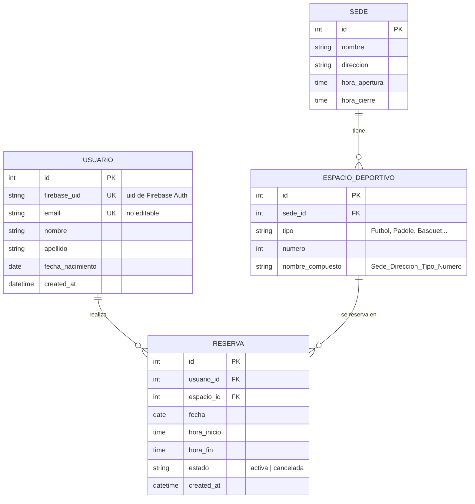

# Modelo de datos — ClubMartinianoHerenu

## Diagrama entidad-relación



## Entidades

### usuario
Se sincroniza con Firebase Auth. Firebase maneja la contraseña; nosotros guardamos
solo el perfil. El `email` no se puede editar (requisito). `firebase_uid` es el
vínculo con el token que llega en cada request.

### sede
Horario de funcionamiento simple (una apertura / un cierre para todos los días).
> Alternativa si se necesita horario distinto por día: tabla `horario_sede`
> (`sede_id`, `dia_semana`, `hora_apertura`, `hora_cierre`). Se deja como mejora
> opcional; para el MVP alcanza con apertura/cierre únicos.

### espacio_deportivo
`nombre_compuesto` se genera a partir de sede + dirección + tipo + número
(ej: `Moron_Rivadavia_19850_Paddle_1`). Puede almacenarse o calcularse al vuelo.

### reserva
`estado` permite "cancelar" sin borrar el registro (así el historial se conserva,
incluyendo reservas finalizadas). Una reserva **cancelada** libera el horario:
la validación de solapamiento solo mira reservas con `estado = 'activa'`.

- **Reserva activa vs. finalizada:** no hace falta un estado "finalizada" en la
  base; se deriva comparando `fecha`/`hora_fin` con el momento actual.
  - Próximas / vigentes: `estado='activa'` y fin en el futuro.
  - Historial: todas las del usuario (incluye pasadas y canceladas).

## Regla de solapamiento (pseudo-SQL)

Al insertar una reserva para `espacio_id`, `fecha`, `[hora_inicio, hora_fin)`:

```sql
SELECT 1 FROM reserva
WHERE espacio_id = :espacio_id
  AND fecha      = :fecha
  AND estado     = 'activa'
  AND hora_inicio < :hora_fin      -- se cruzan si...
  AND hora_fin    > :hora_inicio;  -- ...cada uno empieza antes de que el otro termine
-- Si devuelve fila -> horario ocupado -> rechazar (409 Conflict).
```

## Datos semilla (seed)

Para que la app tenga contenido desde el inicio, se cargan por script:
- 2–3 sedes con nombre, dirección y horarios.
- Varios espacios por sede de distintos tipos (Fútbol, Paddle, Básquet)
  con su nombre compuesto.
