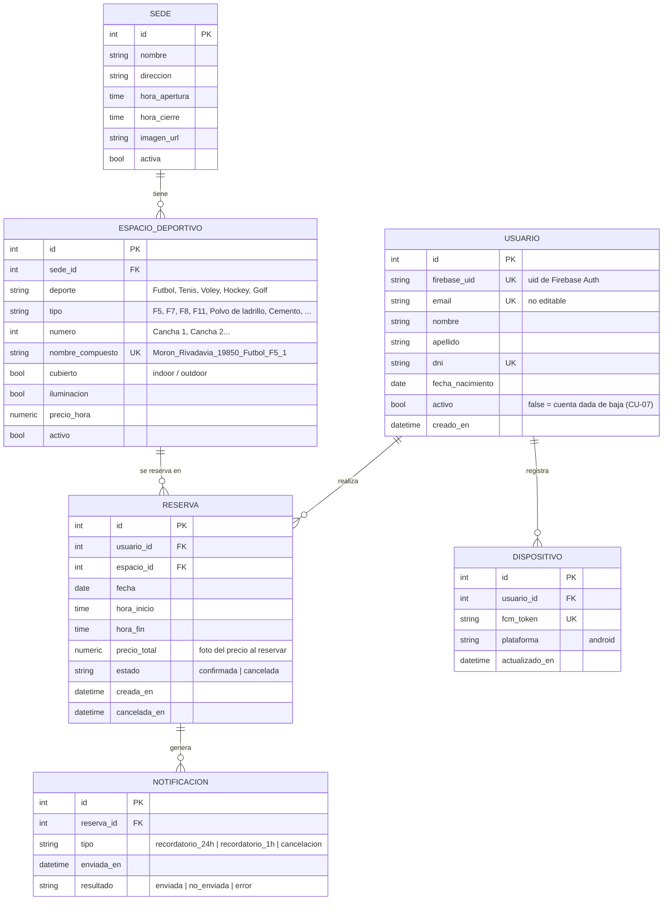

# Modelo de datos — ClubMartinianoHerenu

> Versión 2 (2026-10-10). Rehecho a partir del Figma grupal y de las especificaciones
> de CU del grupo. Reemplaza al borrador de agosto (que no tenía precios, ni
> deporte/tipo, ni notificaciones).

## Diagrama entidad-relación



## Entidades

### usuario
- Firebase Authentication guarda el email y la **contraseña**; nuestra base guarda
  solo el perfil (módulo 9: "la contraseña no se guarda en PostgreSQL").
- `firebase_uid` vincula el token que llega en cada request con la fila del usuario.
- `dni` es único: el CU-03 pide rechazar el registro si el email **o el DNI** ya existen.
- `email` no se puede editar (requisito del TP y CU-06).
- Dar la cuenta de baja (CU-07) marca `activo = false`, borra el usuario de Firebase
  y cancela sus reservas futuras. No se borra la fila para no perder el historial.

### sede
- Datos mínimos del TP: nombre, dirección y horario de funcionamiento.
- Un único horario de apertura y cierre para todos los días (igual que los
  formularios de alta y edición de sede del Figma).
- Seed: Morón, Ramos Mejía, San Justo y Castelar.

### espacio_deportivo
- `deporte` + `tipo` reproducen el catálogo del Figma:

  | Deporte | Tipos |
  |---|---|
  | Fútbol | F5, F7, F8, F11 |
  | Tenis | Polvo de ladrillo, Cemento, Sintético |
  | Vóley | Playa, Indoor parquet |
  | Hockey | H7, H11 |
  | Golf | Driving range, 9 hoyos |

- `numero` permite tener "Cancha 1" y "Cancha 2" del mismo tipo (el selector de cancha del CU-12).
- `nombre_compuesto` sigue el formato del TP y del CU-21:
  `Sede_Direccion_Deporte_Tipo_Numero`, por ejemplo `Moron_Rivadavia_19850_Futbol_F5_1`.
- `precio_hora` alimenta el resumen y el total que muestra el Figma (precio
  informativo: no hay pagos).
- `cubierto` e `iluminacion` son los atributos que muestra la tarjeta de cancha del CU-16.

### reserva
- Una reserva es espacio + fecha + hora de inicio + hora de fin (definición del TP).
- La duración es de 1 o 2 horas (selector del CU-12), siempre en horas completas.
- `precio_total` = `precio_hora` × horas, guardado al reservar para que un cambio
  de precio no altere reservas ya hechas.
- `estado`:
  - `confirmada`: reserva vigente (CU-09).
  - `cancelada`: la canceló el usuario (CU-10). Libera el horario.
- **"Completada" no se guarda**: se deriva (`confirmada` y ya terminó). Así
  "Próximas" e "Historial" (CU-08) salen de la misma tabla sin procesos que
  actualicen estados.

### dispositivo
- Guarda el token de Firebase Cloud Messaging de cada celular con sesión iniciada
  (CU-24, precondición). Se borra al cerrar sesión o cuando FCM informa que el
  token ya no es válido (CU-24, FA3).

### notificacion
- Registro de cada aviso enviado. La combinación (`reserva_id`, `tipo`) es única:
  así un mismo recordatorio nunca se manda dos veces (CU-24, poscondición).

## Reglas de negocio (las valida el backend)

Al crear una reserva (`POST /reservas`):

1. El espacio existe y está activo; su sede está activa.
2. `hora_inicio` y `hora_fin` en minuto 00; duración de 1 o 2 horas.
3. El inicio es **futuro** respecto de ahora (hora de Argentina).
4. `hora_apertura ≤ hora_inicio` y `hora_fin ≤ hora_cierre` de la sede.
5. **Sin superposición** con otra reserva `confirmada` del mismo espacio y fecha:

```sql
SELECT 1 FROM reserva
WHERE espacio_id = :espacio_id
  AND fecha      = :fecha
  AND estado     = 'confirmada'
  AND hora_inicio < :hora_fin
  AND hora_fin    > :hora_inicio;
-- Si devuelve una fila: horario ocupado -> 409 Conflict.
```

Para que dos usuarios no reserven el mismo turno a la vez, la verificación y el
`INSERT` se hacen en la misma transacción, bloqueando el espacio (`SELECT ... FOR UPDATE`).

Al cancelar (`DELETE /reservas/{id}`): la reserva tiene que ser del usuario, estar
`confirmada` y no haber empezado (CU-10, FA4). Si no, 409.

## Disponibilidad (CU-12)

No se guarda: se **calcula** en cada consulta para un espacio, una fecha y una duración:

1. Se generan las franjas desde la apertura hasta el cierre de la sede, de hora en
   hora, cada una del largo de la duración elegida.
2. Una franja está **no disponible** si se superpone con una reserva `confirmada` o
   si ya pasó (cuando la fecha es hoy).
3. Se devuelven todas las franjas con su marca de disponible / no disponible, más
   el precio. Si ninguna está libre, la app muestra el estado "No hay horarios
   disponibles" (CU-12, FA4).

## Datos semilla (seed)

Script que carga las 4 sedes y sus canchas tal como aparecen en el Figma, con
precios. Por ejemplo, la sede Morón tiene Fútbol F5 Cancha 1 y 2, F7 y F11, y
Tenis polvo de ladrillo y cemento.
